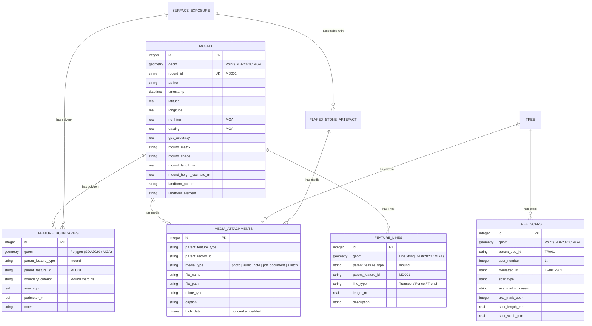
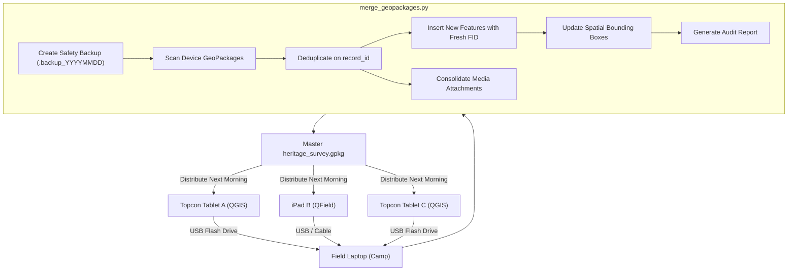

# Technical Architecture Specification: GeopackageV1 (v0.2)

## 1. System Overview & Rationale

**GeopackageV1 (v0.2)** transitions the bespoke, Android-dependent FAIMS 2 archaeological field recording schema into an open, modern, cross-platform geospatial recording architecture based on the **OGC GeoPackage Standard (v1.2/1.3)**.

### Core Objectives (v0.2)
1. **Single Open Container**: Consolidate 8 separate FAIMS modules (7 Phase 1 landscape modules and 1 complex Phase 2 object module) into a **single, self-contained GeoPackage file** (`heritage_survey.gpkg`).
2. **National Coordinate Standard (GDA2020)**: Full native support for Australia's official datum **GDA2020** (EPSG:7844 Geographic 2D) and **MGA2020 Zones 49 through 56** (EPSG:7849–7856) with interactive and CLI selection.
3. **100% Disconnected Offline Fieldwork**: Purpose-built for remote outback/bush locations with zero mobile reception (no 4G/5G, no internet). Native support for:
   * **Topcon FC-6000 Windows Rugged Tablets** running QGIS Desktop.
   * **Apple iPads** running QField.
4. **End-of-Day Multi-Device Consolidation (`merge_geopackages.py`)**: Automatic merging, safety backup, and deduplication of field data collected simultaneously across multiple tablets and iPads back at camp.
5. **Native Vector Geometries**: Elimination of legacy 'boundary coordinates' (point-by-point workarounds from older hardware) in favour of native QGIS polygon (`feature_boundaries`) and line (`feature_lines`) digitizing.
6. **Multi-Format Media Pipeline**: Structured management of site and artefact photos, audio notes, and PDF site plans/sketches via `media_attachments`.
7. **Generic Australian Scope**: Fully generalized schema applicable across all Australian states and territories (author: Mick Morrison).

---

## 2. Spatial Database Architecture (`heritage_survey.gpkg`)

The GeoPackage is built on SQLite 3 with standard OGC tables (`gpkg_spatial_ref_sys`, `gpkg_contents`, `gpkg_geometry_columns`).

### 2.1 Coordinate Reference Systems (GDA2020 / MGA2020)

Australia's modern datum is the **Geocentric Datum of Australia 2020 (GDA2020)**, based on the GRS80 ellipsoid:
* **EPSG:7844 (GDA2020 Geographic 2D)**: Lat/Long degrees for continental or multi-zone work.
* **EPSG:7849 to 7856 (GDA2020 / MGA Zones 49 to 56)**: Universal Transverse Mercator (UTM) metric projections covering all Australian states and territories.

All point, polygon, and line features are stored natively in the survey's chosen MGA zone (or GDA2020 geographic degrees), with sub-centimeter Transverse Mercator forward/inverse conversions.

### 2.2 Table Hierarchy



---

## 3. Data Dictionary & Controlled Vocabularies

The 111 XML vocabulary files located in `vocab/` have been extracted and loaded as dedicated lookup tables in the GeoPackage:
* **Table Naming**: `vocab_<name>` (e.g. `vocab_landform_pattern`, `vocab_stoneartefact_rawmaterial`).
* **Columns**: `id`, `code`, `label`, `parent_term`, `description`, `display_order`.
* **Hierarchical Support**: Vocabularies with parent-child relationships (e.g., `buttons_type`, `ceram_type`, `glass_vessel`, `landform_elements`, `veg_struct_form`) maintain their hierarchy via `parent_term`.
* **QGIS ValueMap Widgets**: Injected directly into the `.qgs` layer field configurations, generating touch-friendly dropdown menus in desktop QGIS and QField.

---

## 4. Native Polygon & Line Digitizing (Removal of Boundary Points)

In older recording systems (FAIMS 2), polygons had to be approximated by taking individual boundary points (`MD001-BP1`, `MD001-BP2`) due to the absence of native polygon digitizing in mobile apps at the time.

In **GeopackageV1 (v0.2)**:
* Legacy `boundary_coordinates` table has been removed.
* Two dedicated spatial layers handle non-point extents:
  1. `feature_boundaries` (**Polygon**): Used for site margins, surface exposure extents, and excavation boundaries.
  2. `feature_lines` (**LineString**): Used for linear cultural features (fences, historical tracks, transect lines, survey baselines).
* Surveyors on Topcon FC-6000 tablets or iPads digitize directly on the screen using native QGIS / QField polygon and vertex editing tools.
* Planar area ($m^2$) and perimeter ($m$) are calculated automatically based on the projected MGA2020 coordinates.

---

## 5. Multi-Device Offline Fieldwork Architecture

### 5.1 Disconnected Operation
* In remote outback or bush settings with zero cellular reception, devices work 100% offline.
* **Topcon FC-6000**: Runs QGIS with direct COM port connection to the internal multi-constellation u-blox GNSS receiver.
* **Apple iPad**: Runs QField using internal GPS or external Bluetooth GNSS (Trimble R1, Bad Elf, Emlid Reach).
* **Basemaps**: Cached offline `.mbtiles` packages are loaded locally, avoiding blank maps when offline.

### 5.2 ID Collision Avoidance
Each tablet is assigned a distinct prefix (`MM`, `TAB1`, `IPAD1`). Recorded IDs follow the pattern `<LAYER_PREFIX>-<DEVICE_PREFIX>-<NUMBER>` (e.g., `MD-MM-001`, `MD-TAB1-001`). This ensures complete uniqueness across all team members.

### 5.3 Multi-Device Consolidation (`merge_geopackages.py`)


---

## 6. Software Architecture & Utilities

```
GeopackageV1/
├── generate_geopackage.py         # Main database generator (GDA2020 / MGA Zones 49-56)
├── export_qgis_project.py         # QGIS .qgs project builder with OGR provider tags
├── merge_geopackages.py           # Multi-device offline synchronization & consolidation
├── parse_faims_schema.py          # Extractor utility for legacy FAIMS XML definitions
├── data/
│   ├── heritage_survey.gpkg       # SQLite OGC GeoPackage database
│   └── heritage_survey.qgs        # Synchronized QGIS 3 desktop/tablet project
├── schema/
│   ├── faims_extracted_schema.json# Extracted normalized schema (17 entities, 716 fields)
│   └── vocabularies.json          # 111 controlled vocabularies
└── media/                         # Field media repository
```

### Zero-Dependency Design
* Built exclusively using Python 3 standard libraries (`sqlite3`, `struct`, `json`, `math`, `argparse`, `shutil`, `datetime`).
* **Zero `pip install` required**, ensuring immediate deployment on any field tablet or laptop without dependency conflicts.
